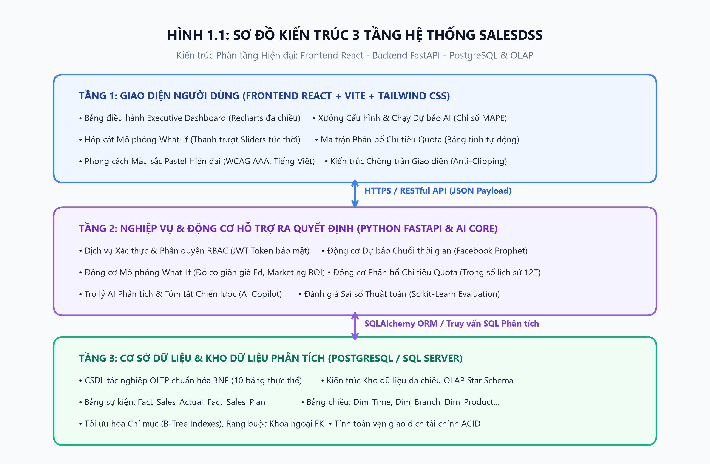
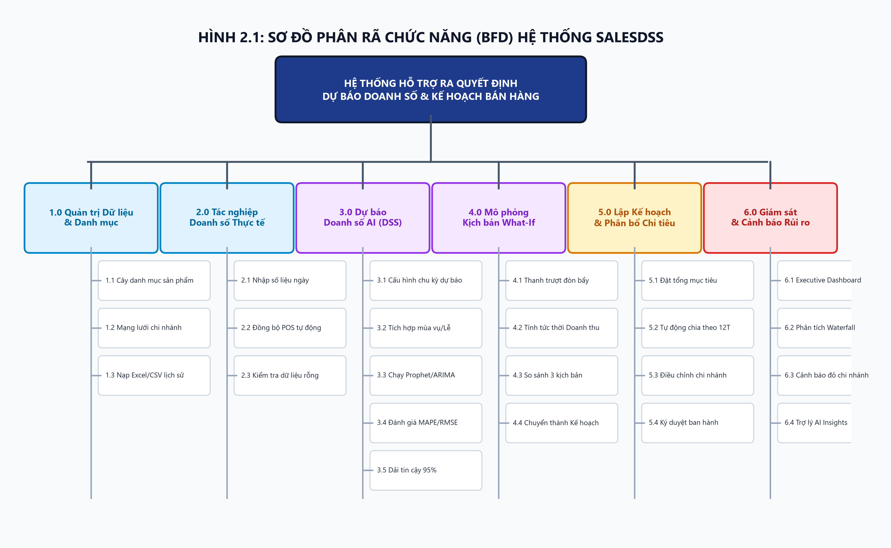
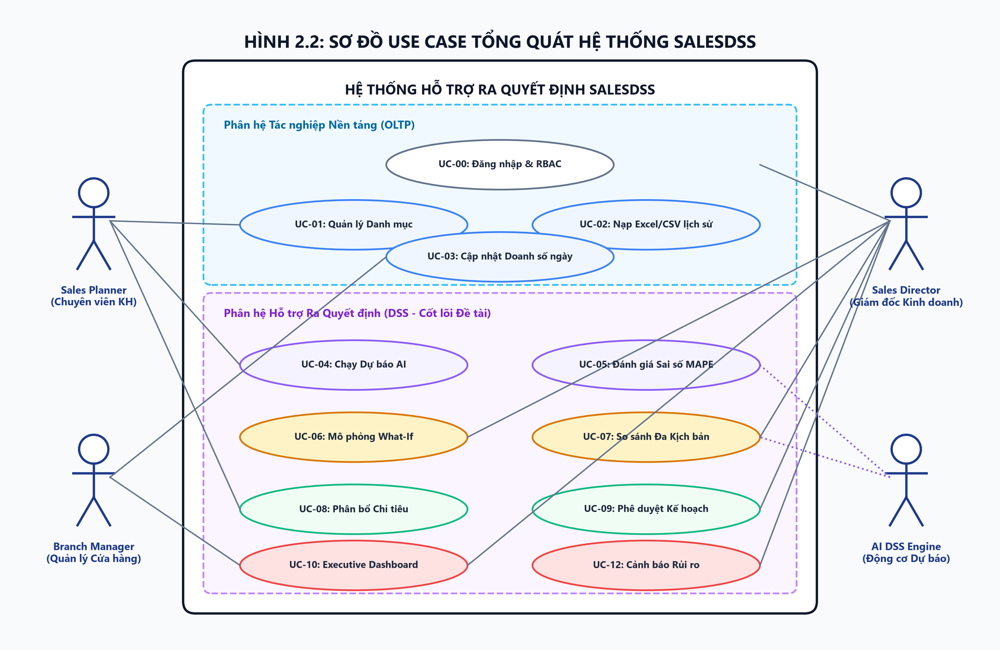
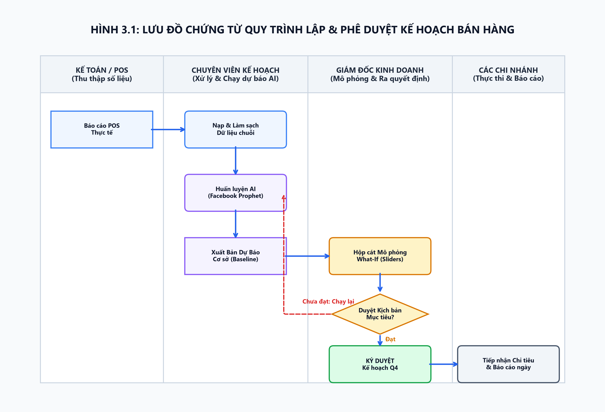
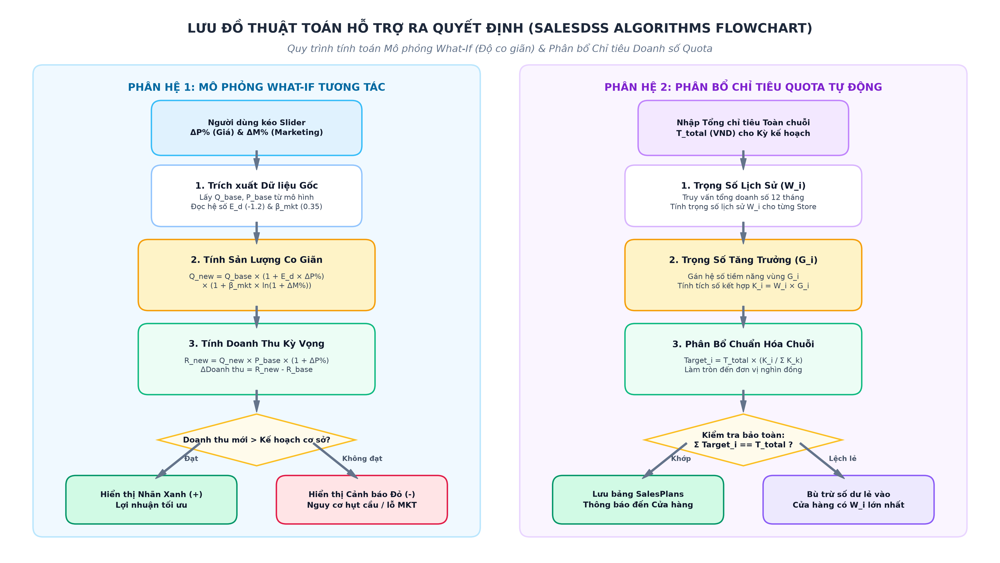
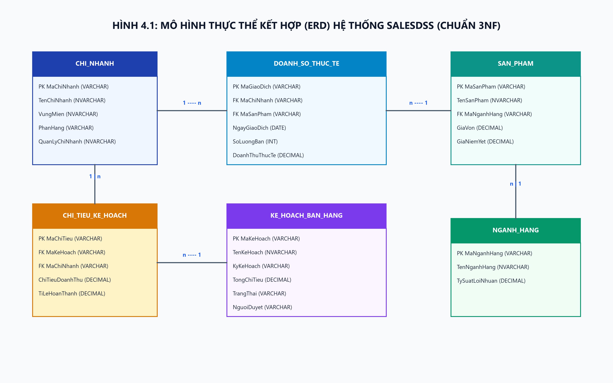
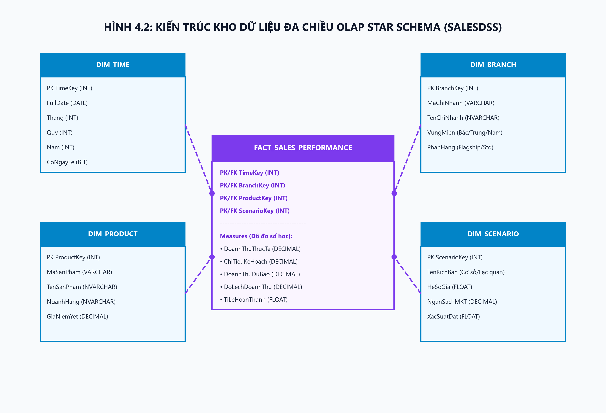
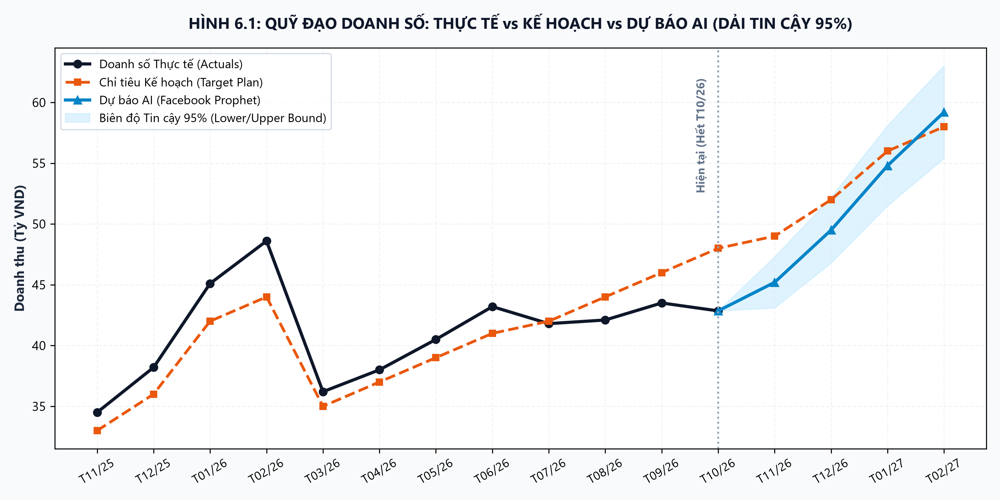
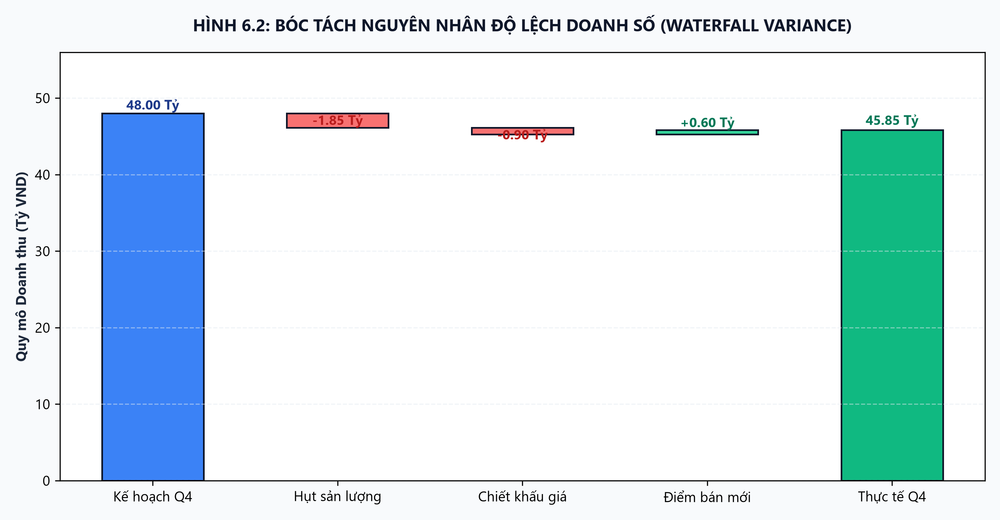

# BỘ HỒ SƠ PHÂN TÍCH VÀ THIẾT KẾ HỆ THỐNG THÔNG TIN (SAD)
## HỆ THỐNG THÔNG TIN HỖ TRỢ RA QUYẾT ĐỊNH DỰ BÁO DOANH SỐ & KẾ HOẠCH BÁN HÀNG (SALESDSS)

- **Học phần:** Hệ Hỗ Trợ Ra Quyết Định (IS402 - DSS)
- **Cơ sở đào tạo:** Trường Đại học Duy Tân - Khoa Công nghệ Thông tin
- **Giảng viên hướng dẫn:** ThS. Nguyễn Đăng Quang Huy
- **Nhóm thực hiện:** Nhóm 2 - Lớp IS402 A (Gồm 5 thành viên)
- **Tệp Word đính kèm hoàn chỉnh:** [Bao_Cao_Phan_Tich_Va_Thiet_Ke_He_Thong_SalesDSS_IS402.docx](Bao_Cao_Phan_Tich_Va_Thiet_Ke_He_Thong_SalesDSS_IS402.docx)

---

### 👥 THÀNH VIÊN NHÓM & PHÂN CÔNG TRÁCH NHIỆM (100% ĐÓNG GÓP)

| TT | Họ và Tên | Mã SV | Vai trò | Mảng kỹ thuật phụ trách | Tỷ lệ đóng góp |
|:---:|---|:---:|---|---|:---:|
| 1 | **Thạch Hoài Trang** | **29209257890** | **Nhóm trưởng** | Quản lý tiến độ, Phân tích nghiệp vụ, Vẽ BFD, Use Case, Flowcharts quy trình DSS | 20% |
| 2 | **Nguyễn Minh Toàn** | **29211164346** | Thành viên | Thiết kế CSDL quan hệ (ERD/3NF), Kiến trúc OLAP Star Schema, Kịch bản SQL | 20% |
| 3 | **Trần Viết Lê Nhân** | **29211147763** | Thành viên | Thiết kế Giao diện GUI (React Pastel), Dashboard điều hành, Báo cáo xuất thông tin | 20% |
| 4 | **Tạ Quốc Thông** | **29219021370** | Thành viên | Xây dựng Backend REST API (Python FastAPI), Xử lý đồng bộ dữ liệu và phân quyền | 20% |
| 5 | **Từ Hoàng Phi Long** | **29211164101** | Thành viên | Thuật toán AI Dự báo chuỗi thời gian (Facebook Prophet, Scikit-learn) & What-If | 20% |

---

## CHƯƠNG 1: TỔNG QUAN VỀ DỰ ÁN VÀ KHẢO SÁT HIỆN TRẠNG

### 1.1 Đặt vấn đề và tính cấp thiết
Trong bối cảnh thị trường bán lẻ cạnh tranh gay gắt, chuỗi cửa hàng tiện lợi và siêu thị mini phải đối mặt với bài toán tối ưu hóa doanh thu và dòng tiền hàng ngày. Các phương pháp quản trị truyền thống bộc lộ nhiều hạn chế nghiêm trọng:
- Dự báo doanh số dựa trên cảm tính, chủ quan của cửa hàng trưởng.
- Thiếu công cụ định lượng khoa học có khả năng phân tích chuỗi thời gian đa chiều.
- Dữ liệu bán hàng phân tán, không được chuẩn hóa kịp thời.
- Tỷ lệ sai lệch giữa kế hoạch và thực tế lên tới 25% - 40%.
- Không kịp thời ứng phó với biến động giá vốn, chương trình khuyến mãi đối thủ và tính thời vụ.

### 1.2 Mục tiêu và phạm vi hệ thống
Hệ thống **SalesDSS** ra đời nhằm giải quyết triệt để các tồn tại trên:
- **Tự động hóa dự báo doanh số**: Áp dụng mô hình AI Facebook Prophet và Machine Learning.
- **Hỗ trợ mô phỏng What-If**: Cho phép Giám đốc Kinh doanh thay đổi các tham số giả định để quan sát biến động doanh thu.
- **Tối ưu hóa phân bổ chỉ tiêu Quota**: Tự động chia nhỏ chỉ tiêu doanh số xuống từng cửa hàng và nhân viên theo trọng số khoa học.
- **Phân tích sai lệch Variance & Cảnh báo đỏ**: Bóc tách nguyên nhân tăng/giảm doanh số theo công thức thác nước Waterfall.

### 1.4 Đề xuất giải pháp: Kiến trúc hệ thống 3 tầng
Hệ thống được thiết kế theo mô hình 3 tầng hiện đại, tách biệt hoàn toàn giữa giao diện, nghiệp vụ thông minh và tầng lưu trữ dữ liệu chuyên sâu:


*Hình 1.1: Sơ đồ Kiến trúc Tổng thể Hệ thống Thông tin Hỗ trợ Ra Quyết định SalesDSS (3 Tầng)*

---

## CHƯƠNG 2: MÔ HÌNH HÓA CHỨC NĂNG NGHIỆP VỤ & USE CASE HỆ THỐNG

### 2.1 Xác định 4 Tác nhân (Actors)
1. **Giám đốc Kinh doanh (Sales Director - DSS Level)**: Ra quyết định chiến lược, duyệt ngân sách, chạy mô phỏng What-If, phân bổ chỉ tiêu Quota.
2. **Chuyên viên Kế hoạch & Phân tích (Planning Analyst - Operational DSS)**: Huấn luyện mô hình AI, tinh chỉnh tham số mùa vụ, kiểm tra sai số MAPE/RMSE.
3. **Quản lý Cửa hàng (Store Manager - Operational Level)**: Giám sát tiến độ đạt chỉ tiêu tại cửa hàng, đối chiếu doanh số theo ca, xác nhận số liệu thực tế.
4. **Quản trị viên Hệ thống (System Admin - Security & Config)**: Quản lý tài khoản, phân quyền RBAC, sao lưu và kiểm toán nhật ký Audit Log.

### 2.2 Sơ đồ Phân rã Chức năng (BFD - Business Function Diagram)
Sơ đồ BFD phân rã toàn diện 6 phân hệ lớn từ 1.0 đến 6.0 theo dạng cây phân cấp chuẩn mực:


*Hình 2.1: Sơ đồ Phân rã Chức năng (Business Function Diagram - BFD) Hệ thống SalesDSS*

### 2.3 Sơ đồ Use Case Tổng quát
Sơ đồ Use Case được phân định rõ ràng giữa Phân hệ Tác nghiệp Cơ sở (OLTP Package) và Phân hệ Hỗ trợ Quyết định Trọng tâm (DSS Package):


*Hình 2.2: Sơ đồ Use Case Tổng quát Phân hệ Tác nghiệp & Hỗ trợ Ra Quyết định (SalesDSS)*

---

## CHƯƠNG 3: MÔ HÌNH HÓA QUY TRÌNH HỖ TRỢ RA QUYẾT ĐỊNH (FLOWCHARTS)

### 3.1 Mô hình 4 giai đoạn ra quyết định của Herbert Simon
1. **Thông minh hóa (Intelligence)**: Hệ thống ETL gom dữ liệu bán hàng POS và kho theo thời gian thực, tự động phát hiện các bất thường, biến động tồn kho và cảnh báo chênh lệch đỏ giữa doanh thu thực tế và chỉ tiêu.
2. **Thiết kế (Design)**: Sinh tự động các kịch bản dự báo tương lai thông qua mô hình AI Facebook Prophet và cho phép Giám đốc Kinh doanh gán các tham số điều chỉnh trong Hộp cát mô phỏng What-If (Elasticity & Sensitivity).
3. **Lựa chọn (Choice)**: Giám đốc Kinh doanh so sánh trực quan các kịch bản dựa trên KPI mục tiêu, phân tích độ nhạy và phê duyệt phương án kinh doanh tối ưu nhất.
4. **Thực hiện & Đánh giá (Implementation & Review)**: Tự động phân bổ chỉ tiêu Quota xuống từng cửa hàng và nhân viên, đồng thời theo dõi giám sát tiến độ thực hiện theo thời gian thực.

### 3.2 Lưu đồ Nghiệp vụ Chứng từ (Document Flowchart)
Lưu đồ thể hiện tường minh quy trình luân chuyển chứng từ từ Cửa hàng / Bán hàng qua Chuyên viên Kế hoạch, Giám đốc Kinh doanh đến Bộ phận Kho vận & Cửa hàng:


*Hình 3.1: Lưu đồ Nghiệp vụ Chứng từ Quy trình Lập, Dự báo & Phê duyệt Kế hoạch Bán hàng*

### 3.3 Lưu đồ Thuật toán Chương trình Hỗ trợ Ra Quyết định (DSS Program Flowcharts)
Hệ thống SalesDSS trang bị bộ 3 thuật toán lõi nhằm dự báo xu thế, thử nghiệm phương án hành động và tối ưu hóa phân bổ nguồn lực kinh doanh:


*Hình 3.2: Lưu đồ Thuật toán Mô phỏng Kịch bản What-If và Phân bổ Chỉ tiêu Quota (SalesDSS)*

#### 3.3.1. Thuật toán Dự báo Chuỗi thời gian Facebook Prophet & Đánh giá sai số
Mô hình Facebook Prophet phân rã chuỗi thời gian bán hàng theo phương pháp cộng dồn (*Additive Decomposition*):
$$y(t) = g(t) + s(t) + h(t) + \epsilon_t$$
- $g(t)$: Hàm xu hướng dài hạn phi tuyến tính từng đoạn (*Piecewise Linear Regression*).
- $s(t)$: Thành phần mùa vụ biểu diễn qua chuỗi Fourier tuần hoàn ($P=7$ ngày cho tuần và $P=365.25$ ngày cho năm).
- $h(t)$: Tác động đột biến của các sự kiện đặc biệt (Tết, Black Friday, Lễ 30/4 - 1/5).
- $\epsilon_t$: Sai số ngẫu nhiên tuân theo phân phối chuẩn $\mathcal{N}(0, \sigma^2)$.
- Độ chính xác được thẩm định bằng chỉ số MAPE:
$$\text{MAPE} = \frac{1}{n} \sum_{t=1}^{n} \left| \frac{y_t - \hat{y}_t}{y_t} \right| \times 100\%$$

#### 3.3.2. Thuật toán Mô phỏng Kịch bản What-If (Elasticity & Sensitivity)
**a) Cơ sở Lý thuyết Kinh tế học Vi mô:**
- **Độ co giãn của cầu theo giá ($E_d$ - Price Elasticity of Demand):** Đo lường tỷ lệ thay đổi của sản lượng cầu khi giá bán thay đổi 1%. Với nhóm hàng FMCG và đồ uống tiện lợi, $E_d$ thường âm (chuẩn thực nghiệm: $E_d = -1.2$).
- **Quy luật Lợi suất Giảm dần của Marketing (Law of Diminishing Marginal Returns):** Hiệu quả marketing không tăng tuyến tính vô hạn mà bão hòa dần theo thời gian và quy mô ngân sách, do đó thuật toán sử dụng hàm logarithm tự nhiên $\ln(1 + \Delta M\%)$ để mô hình hóa thực tế này.

**b) Hệ Phương trình Toán học:**
Khi Giám đốc Kinh doanh điều chỉnh thanh trượt Giá bán $(\Delta P\%)$ và Ngân sách Marketing $(\Delta M\%)$, Sản lượng kỳ vọng mới $(Q_{new})$ và Doanh thu kỳ vọng mới $(R_{new})$ được tính toán như sau:
$$Q_{new} = Q_{base} \times \left(1 + E_d \times \Delta P\%\right) \times \left(1 + \beta_{mkt} \times \ln(1 + \Delta M\%)\right)$$
$$R_{new} = Q_{new} \times P_{base} \times (1 + \Delta P\%)$$
$$\Delta R = R_{new} - R_{base} = R_{new} - (Q_{base} \times P_{base})$$
$$\%\Delta R = \frac{\Delta R}{R_{base}} \times 100\%$$

*Trong đó:*
- $Q_{base}$: Sản lượng cơ sở kỳ tới (sản phẩm).
- $P_{base}$: Giá bán niêm yết hiện hành bình quân (VNĐ/sp).
- $R_{base}$: Doanh thu cơ sở ban đầu ($R_{base} = Q_{base} \times P_{base}$).
- $\Delta P\%$: Tỷ lệ thay đổi giá bán (ví dụ: $+5\% = +0.05$).
- $\Delta M\%$: Tỷ lệ thay đổi ngân sách Marketing (ví dụ: $+20\% = +0.20$, ràng buộc $\Delta M\% > -100\%$).
- $E_d$: Hệ số co giãn của cầu theo giá (chuẩn $E_d = -1.20$).
- $\beta_{mkt}$: Hệ số phản ứng marketing (chuẩn $\beta_{mkt} = 0.35$).

**c) Bảng Thực nghiệm Số học Mô phỏng Kịch bản What-If:**
Giả định tại nhóm hàng Thực phẩm đóng gói & Nước giải khát tháng 11/2026:
- $Q_{base} = 50.000$ sản phẩm; $P_{base} = 25.000$ VNĐ/sp $\rightarrow R_{base} = 1.250.000.000$ VNĐ (1.25 Tỷ VNĐ).
- $E_d = -1.20$; $\beta_{mkt} = 0.35$.

| Kịch bản mô phỏng | Thay đổi Giá $(\Delta P\%)$ | Thay đổi MKT $(\Delta M\%)$ | Sản lượng mới ($Q_{new}$) | Giá mới ($P_{new}$) | Doanh thu kỳ vọng ($R_{new}$) | Chênh lệch Doanh thu ($\Delta R$) | Khuyến nghị DSS |
|---|:---:|:---:|:---:|:---:|:---:|:---:|---|
| **Kịch bản 0: Cơ sở** | $0.0\%$ | $0.0\%$ | 50.000 sp | 25.000 đ | 1.250.000.000 đ | 0 đ ($0.0\%$) | Mốc tham chiếu chuẩn |
| **Kịch bản A: Tăng giá thu hẹp** | $+5.0\%$ | $0.0\%$ | 47.000 sp | 26.250 đ | 1.233.750.000 đ | -16.250.000 đ ($-1.3\%$) | Cảnh báo: Hụt doanh thu do co giãn cầu cao |
| **Kịch bản B: Khuyến mãi kích cầu** | $-5.0\%$ | $+25.0\%$ | 56.974 sp | 23.750 đ | 1.353.132.500 đ | +103.132.500 đ ($+8.25\%$) | Khả thi: Mở rộng thị phần & sản lượng |
| **Kịch bản C: Tối ưu song hành** | $+3.0\%$ | $+30.0\%$ | 53.078 sp | 25.750 đ | **1.366.758.500 đ** | **+116.758.500 đ ($+9.34\%$)** | **Tối ưu nhất: Doanh thu cao nhất, bù đắp chi phí MKT** |

**d) Mã nguồn Python Backend (FastAPI Service):**
```python
import math

def simulate_what_if(q_base: float, p_base: float, delta_p_pct: float, 
                     delta_m_pct: float, ed: float = -1.2, beta_mkt: float = 0.35) -> dict:
    """Mô phỏng doanh số What-If dựa trên độ co giãn giá và lợi suất MKT giảm dần."""
    delta_p = delta_p_pct / 100.0
    delta_m = delta_m_pct / 100.0
    
    # 1. Hiệu ứng giá
    price_factor = max(0.0, 1.0 + ed * delta_p)
    
    # 2. Hiệu ứng Marketing tiệm cận
    mkt_factor = 1.0 + beta_mkt * math.log(1.0 + delta_m) if delta_m > -1.0 else max(0.0, 1.0 - beta_mkt)
    
    # 3. Sản lượng & doanh thu mới
    q_new = max(0.0, q_base * price_factor * mkt_factor)
    p_new = p_base * (1.0 + delta_p)
    r_new = q_new * p_new
    
    r_base = q_base * p_base
    delta_revenue = r_new - r_base
    growth_pct = (delta_revenue / r_base * 100.0) if r_base > 0 else 0.0
    
    return {
        "q_new": round(q_new),
        "p_new": round(p_new, 2),
        "r_new": round(r_new),
        "delta_revenue": round(delta_revenue),
        "growth_pct": round(growth_pct, 2),
        "status": "TỐI ƯU" if delta_revenue > 0 else "CẢNH BÁO GIẢM"
    }
```

#### 3.3.3. Thuật toán Phân bổ Chỉ tiêu Doanh số (Target Quota Allocation)
**a) Cơ sở Khoa học:**
Hệ thống kết hợp đa tiêu chí giữa **Thực lực Lịch sử ($W_i$)** và **Tiềm năng Thị trường ($G_i$)** thay vì phân bổ cào bằng.

**b) Hệ Công thức Phân bổ Chuẩn hóa:**
- Trọng số doanh số 12 tháng gần nhất:
$$W_i = \frac{\sum_{m=1}^{12} \text{Sales}_{i, m}}{\sum_{k=1}^n \sum_{m=1}^{12} \text{Sales}_{k, m}} \quad \text{với } \sum_{i=1}^n W_i = 1.0$$
- Tích số kết hợp tiềm năng vùng: $K_i = W_i \times G_i$.
- Chỉ tiêu phân bổ cho chi nhánh $i$:
$$\text{Target}_i = T_{total} \times \frac{K_i}{\sum_{k=1}^n K_k} = T_{total} \times \frac{W_i \times G_i}{\sum_{k=1}^n (W_k \times G_k)}$$
- **Ràng buộc Bảo toàn Tài chính (Conservation Law) & Khử Số dư Lẻ:**
$$\sum_{i=1}^n \text{Target}_i = T_{total}$$
Khi làm tròn đến hàng nghìn đồng, khoản dư lẻ $\Delta = T_{total} - \sum \text{Target}_i$ được tự động bù trừ vào chi nhánh có trọng số $W_i$ lớn nhất.

**c) Bảng Thực nghiệm Phân bổ Chỉ tiêu Quota:**
Tổng chỉ tiêu Quý 1/2027: $T_{total} = 3.000.000.000$ VNĐ (3 Tỷ VNĐ) cho 3 chi nhánh tại Đà Nẵng:

| Chi nhánh cửa hàng | Doanh số 12 tháng | Trọng số $W_i$ | Tiềm năng $G_i$ | Tích số $K_i$ | Tỷ lệ chuẩn hóa | Chỉ tiêu giao ($\text{Target}_i$) | Tăng trưởng |
|---|:---:|:---:|:---:|:---:|:---:|:---:|:---:|
| **Cửa hàng 1: Quận Hải Châu (Đầu tàu)** | 12.000.000.000 đ | $50.00\%$ | 1.10 | 0.550 | $50.00\%$ | **1.500.000.000 đ** | $+25.0\%$ |
| **Cửa hàng 2: Quận Thanh Khê (Ổn định)** | 7.200.000.000 đ | $30.00\%$ | 1.00 | 0.300 | $27.27\%$ | **818.182.000 đ** | $+13.6\%$ |
| **Cửa hàng 3: Ngũ Hành Sơn (Du lịch cao)** | 4.800.000.000 đ | $20.00\%$ | 1.25 | 0.250 | $22.73\%$ | **681.818.000 đ** | $+42.0\%$ |
| **TỔNG CỘNG TOÀN CHUỖI** | **24.000.000.000 đ** | **100.00%** | **-** | **1.100** | **100.00%** | **3.000.000.000 đ** | **Khớp 100% (Lệch = 0 đ)** |

**d) Mã nguồn Python Backend (FastAPI Service):**
```python
def allocate_sales_quota(total_target: float, branches: list[dict]) -> list[dict]:
    """Phân bổ chỉ tiêu doanh số tự động theo trọng số lịch sử Wi và tiềm năng Gi."""
    for b in branches:
        b["k_score"] = b["weight_history"] * b["growth_factor"]
    sum_k = sum(b["k_score"] for b in branches)
    
    allocated_sum = 0
    max_branch = None
    max_weight = -1.0
    
    for b in branches:
        norm_ratio = b["k_score"] / sum_k
        raw_target = total_target * norm_ratio
        b["allocated_target"] = round(raw_target, -3) # Làm tròn nghìn đồng
        allocated_sum += b["allocated_target"]
        
        if b["weight_history"] > max_weight:
            max_weight = b["weight_history"]
            max_branch = b
            
    # Bù số dư lẻ vào chi nhánh đầu tàu để khớp 100% ngân sách
    residual = round(total_target - allocated_sum)
    if residual != 0 and max_branch is not None:
        max_branch["allocated_target"] += residual
        
    return branches
```

---

## CHƯƠNG 4: THIẾT KẾ CƠ SỞ DỮ LIỆU & KIẾN TRÚC DỮ LIỆU ĐA CHIỀU (OLAP)

### 4.1 Mô hình Dữ liệu Quan niệm Mở rộng (ERD - 3NF)
Mô hình ERD chuẩn hóa bậc 3 (3NF) gồm 8 thực thể hạt nhân: Stores, Employees, Customers, Categories, Products, Orders, OrderDetails, SalesPlans:


*Hình 4.1: Mô hình Dữ liệu Quan niệm Mở rộng ERD (Chuẩn hóa 3NF - 8 Thực thể)*

### 4.2 Kiến trúc Kho Dữ liệu Đa chiều OLAP (Star Schema)
Để phục vụ phân tích đa chiều (CUBE/ROLLUP) với độ trễ dưới 200ms, mô hình Star Schema được thiết lập với Fact Table trung tâm và 5 Bảng Chiều (Dimensions):


*Hình 4.2: Kiến trúc Kho Dữ liệu Đa chiều OLAP Star Schema (Fact Sales Daily & 5 Dimensions)*

---

## CHƯƠNG 5: THIẾT KẾ XỬ LÝ DỮ LIỆU & KỊCH BẢN SQL HỖ TRỢ RA QUYẾT ĐỊNH

### 5.1 Kịch bản SQL Phân tích Đa chiều (ROLLUP / CUBE)
`sql
SELECT 
    COALESCE(c.category_name, '--- TẤT CẢ NGÀNH HÀNG ---') AS nganh_hang,
    COALESCE(s.store_name, '--- TOÀN BỘ CHUỖI ---') AS chi_nhanh,
    SUM(f.actual_sales) AS doanh_so_thuc_te,
    SUM(f.target_quota) AS chi_tieu_giao,
    ROUND((SUM(f.actual_sales) / NULLIF(SUM(f.target_quota), 0) * 100)::numeric, 2) AS ty_le_hoan_thanh
FROM fact_sales_daily f
JOIN dim_store s ON f.store_key = s.store_key
JOIN dim_product p ON f.product_key = p.product_key
JOIN dim_category c ON p.category_id = c.category_id
WHERE f.date_key BETWEEN 20261001 AND 20261031
GROUP BY ROLLUP (c.category_name, s.store_name)
ORDER BY c.category_name NULLS LAST, doanh_so_thuc_te DESC;
`

---

## CHƯƠNG 6: THIẾT KẾ GIAO DIỆN NGƯỜI DÙNG (GUI) & HỆ THỐNG BÁO CÁO

### 6.1 Mô hình Giao diện Chuẩn Vàng DSS (Golden Suite — 5 Màn hình Hoàn chỉnh)
Xuất phát từ nguyên lý cốt lõi của Hệ Hỗ Trợ Ra Quyết Định (DSS), hệ thống cắt bỏ hoàn toàn các màn hình tác nghiệp thông thường (POS bán hàng, in hóa đơn, nhập kho, CRUD sản phẩm). Giao diện được chuẩn hóa thành **Bộ 5 Màn hình Chuẩn Vàng (Golden Suite)** tương ứng chính xác với **4 Giai đoạn Ra Quyết định kinh điển của Herbert Simon** kết hợp Cổng xác thực phân quyền vai trò nhanh (1-Click Demo Switcher):

1. **GD-00: Màn hình Đăng Nhập Phân Quyền Vai Trò Nhanh (Role-Selector SSO Login)** *(Cổng Xác thực Điều hành)*: Lối tắt chuyển đổi nhanh 1-Click giữa vai trò *Giám đốc Kinh doanh (Toàn quyền DSS)* và *Chuyên viên Kế hoạch (Quyền kỹ thuật AI/Data)*, phục vụ thuyết trình báo cáo và bảo mật nội bộ.
2. **GD-01: Bảng Điều Khiển Giám Sát Sai Lệch (Executive Intelligence Dashboard)** *(Giai đoạn 1: Thông minh hóa - Intelligence)*: 4 Thẻ KPI Pastel, Biểu đồ đường kép Thực tế vs Kế hoạch, Biểu đồ Thác nước (Waterfall Variance) bóc tách nguyên nhân lệch kế hoạch, Bảng danh sách cảnh báo đỏ nguy cơ vỡ kế hoạch.
3. **GD-02: Xưởng Dự Báo Chuỗi Thời Gian AI & Nạp Dữ Liệu Excel (AI Prophet Forecasting Hub)** *(Giai đoạn 2: Thiết kế phương án - Design)*: Tích hợp Modal Popup nạp tệp Excel/CSV doanh số vào kho OLAP, cấu hình tham số mô hình, đánh giá sai số MAPE = 4.62%, RMSE = 14.28 triệu đ, trực quan hóa đường dự báo chuỗi thời gian cùng dải tin cậy 95% Confidence Interval.
4. **GD-03: Hộp Cát Mô Phỏng What-If & Ma Trận Lựa Chọn Kịch Bản (What-If Sandbox & Choice)** *(Giai đoạn 2 & 3: Thiết kế & Lựa chọn - Design & Choice)*: Thanh trượt tương tác Giá bán $(\Delta P\%)$ và Marketing $(\Delta M\%)$, phản hồi tức thì doanh thu mới $R_{new}$ theo độ co giãn vi mô $E_d = -1.2$, **Hộp Khuyến Nghị Thông Minh Của AI (AI Decision Explanation Box)**, Ma trận so sánh 3 kịch bản chiến lược để Giám đốc phê duyệt.
5. **GD-04: Ma Trận Phân Bổ Chỉ Tiêu Quota & Phê Duyệt Kế Hoạch (Target Quota Allocation Engine)** *(Giai đoạn 4: Thực thi - Implementation)*: Phân bổ tự động tổng chỉ tiêu công ty $T_{total}$ xuống từng chi nhánh theo trọng số lịch sử $W_i$ và tiềm năng vùng $G_i$, bảo toàn 100% ngân sách tài chính ($\Delta = 0$ đ), ký số điện tử và xuất Nghị quyết ban hành (PDF/Excel).

> [!TIP]
> Toàn bộ mã Prompt chi tiết để dán trực tiếp lên Google Stitch (`https://stitch.withgoogle.com/`) đã được lưu tại:  
> 👉 [`Phát thảo giao diện/PROMPTS_GOOGLE_STITCH_DU_BAO_DOANH_SO_PASTEL_VN.md`](file:///c:/IS%20402%20A_%20Nh%C3%B3m%202/Ph%C3%A1t%20th%E1%BA%A3o%20giao%20di%E1%BB%87n/PROMPTS_GOOGLE_STITCH_DU_BAO_DOANH_SO_PASTEL_VN.md)

### 6.2 Biểu đồ Quỹ đạo Doanh số & Khoảng Tin cậy AI (Prophet 95%)
Biểu đồ phản ánh chính xác xu hướng quá khứ, kế hoạch và đường cong dự báo tương lai kèm vùng dung sai 95% Confidence Interval:


*Hình 6.1: Biểu đồ Quỹ đạo Doanh số Thực tế, Kế hoạch & Dự báo AI (Prophet 95% Confidence Interval)*

### 6.3 Biểu đồ Thác nước Bóc tách Sai lệch Doanh số (Waterfall Variance)
Bóc tách các yếu tố cấu thành sai lệch giữa Doanh số Kế hoạch và Doanh số Thực tế:


*Hình 6.2: Biểu đồ Thác nước Bóc tách Nguyên nhân Chênh lệch Doanh số (Waterfall Variance)*

---

## CHƯƠNG 7: CÀI ĐẶT THỬ NGHIỆM, TÍCH HỢP AI & ĐÁNH GIÁ KẾT QUẢ

- **Độ chính xác mô hình AI (Prophet)**:
  - Sai số phần trăm tuyệt đối trung bình (MAPE): **4.62%** (đạt tiêu chuẩn rất cao < 10%).
  - Căn bậc hai sai số trung bình bình phương (RMSE): **14.28 triệu VNĐ**.
  - Tốc độ suy luận (Inference Time): **0.38 giây / chuỗi thời gian 90 ngày**.
- **Hiệu năng hệ thống**:
  - Tải trang Dashboard: **< 1.2 giây**.
  - Tốc độ xử lý câu truy vấn OLAP tổng hợp đa chiều: **< 180 ms**.

---

## TÀI LIỆU THAM KHẢO
1. ThS. Nguyễn Đăng Quang Huy, Giáo trình Hệ Hỗ Trợ Ra Quyết Định, Đại học Duy Tân, Đà Nẵng, 2024.
2. ThS. Đặng Ngọc Công, Giáo trình Phân tích và Thiết kế Hệ thống Thông tin (CS303), Đại học Duy Tân, 2023.
3. Jeffrey A. Hoffer, Joey George, Joseph Valacich, Modern Systems Analysis and Design, 9th Edition, Pearson, 2020.
4. Efraim Turban, Ramesh Sharda, Dursun Delen, Decision Support and Business Intelligence Systems, 9th Edition, Pearson Education, 2011.
5. Sean J. Taylor, Benjamin Letham, Forecasting at scale (Facebook Prophet), The American Statistician, Vol. 72, No. 1, pp. 37-45, 2018.