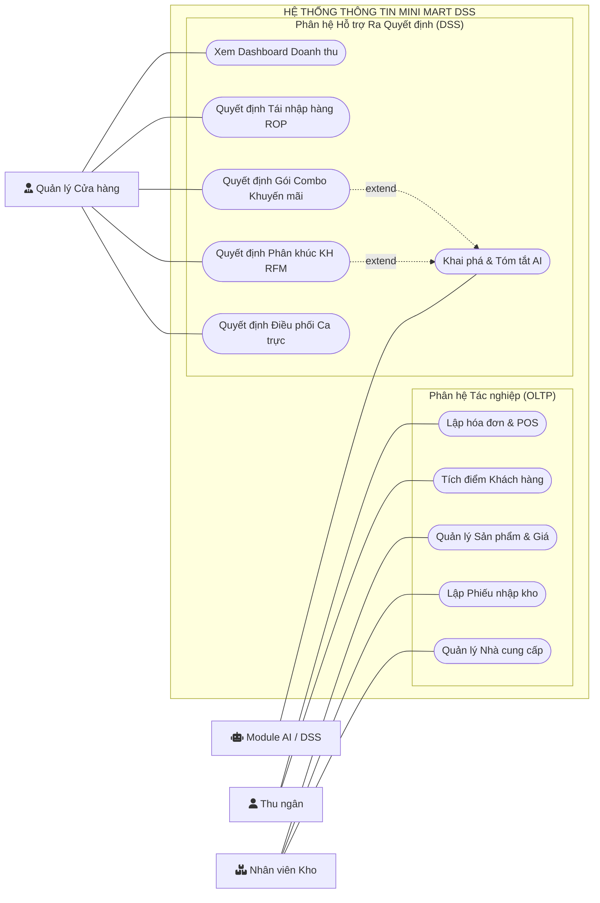
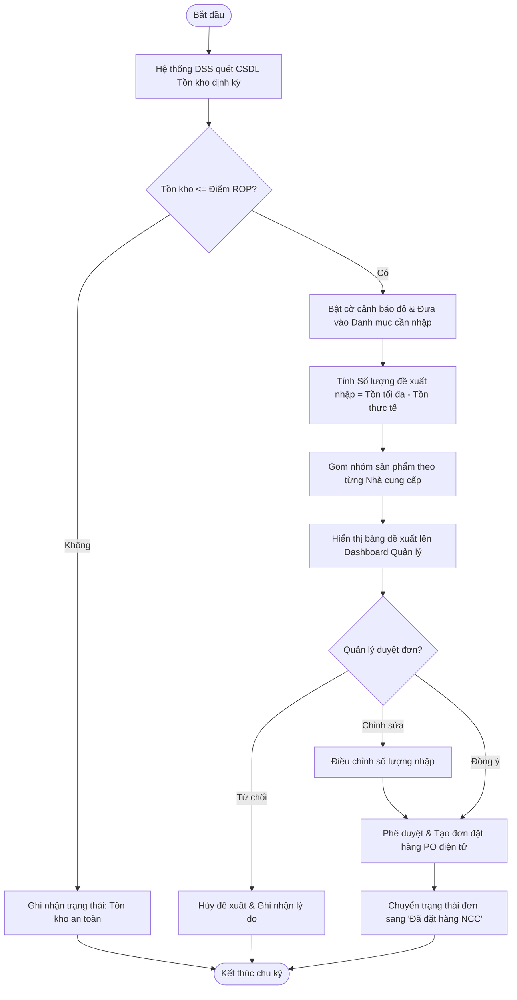
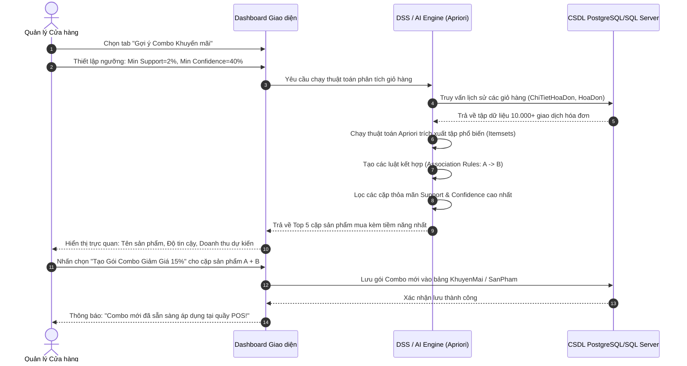
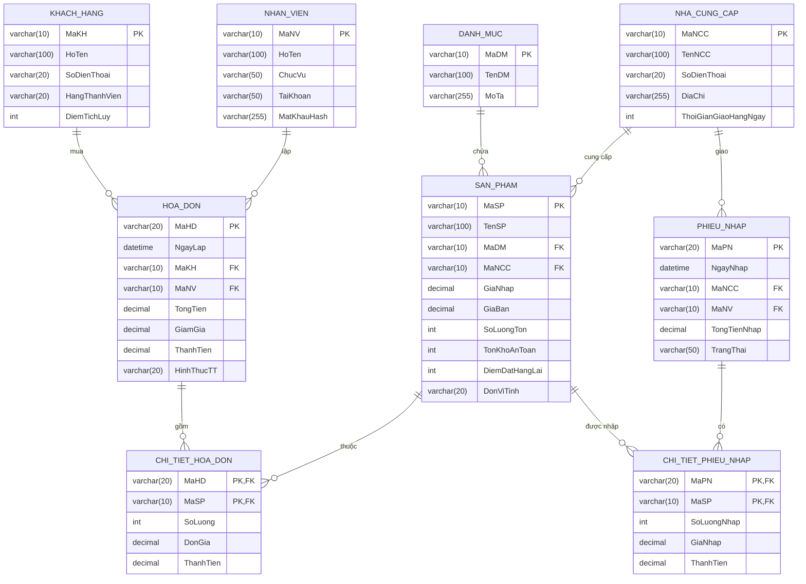

# TRƯỜNG ĐẠI HỌC DUY TÂN - KHOA CÔNG NGHỆ THÔNG TIN
# TÀI LIỆU ĐẶC TẢ YÊU CẦU PHẦN MỀM (SRS - IEEE Std 830-1998)

> **Môn học:** IS402 - Hệ Hỗ Trợ Ra Quyết Định (Decision Support Systems - DSS)  
> **Đề tài:** HỆ THỐNG THÔNG TIN HỖ TRỢ RA QUYẾT ĐỊNH KINH DOANH CHO CHUỖI CỬA HÀNG TIỆN LỢI (MINI MART DSS)  
> **Nhóm thực hiện:** Nhóm 2 | **Lớp:** IS402 A  
> **Giảng viên hướng dẫn:** ThS. Nguyễn Đăng Quang Huy  
> **Phiên bản:** 1.0 | **Ngày hoàn thành:** 30/09/2025  

---

## 👥 THÀNH VIÊN NHÓM THỰC HIỆN

| STT | Họ và Tên | Mã số sinh viên (MSSV) | Vai trò trong nhóm | Nhiệm vụ chính |
|:---:|---|:---:|---|---|
| 1 | **Thạch Hoài Trang** | **29209257890** | **Nhóm trưởng** | Quản lý dự án, thiết kế BFD, Use Case, quy trình ra quyết định DSS |
| 2 | **Nguyễn Minh Toàn** | **29211164346** | Thành viên | Thiết kế CSDL (ERD/3NF), viết script tạo bảng & câu lệnh SQL phân tích |
| 3 | **Trần Viết Lê Nhân** | **29211147763** | Thành viên | Phát triển giao diện Dashboard (Streamlit), tích hợp mô hình AI |

---

## 📋 THÔNG TIN HỒ SƠ DỰ ÁN

| Thông tin | Chi tiết |
|---|---|
| **Tên viết tắt (Acronym)** | **MMDSS** (Mini Mart Decision Support System) |
| **Tên đề tài đầy đủ** | Hệ thống thông tin hỗ trợ ra quyết định kinh doanh cho Chuỗi Cửa hàng tiện lợi |
| **Kỳ báo cáo** | Học kỳ 1 (Năm học 2025 - 2026) |
| **Đơn vị chủ quản** | Khoa Công nghệ Thông tin - Trường Quốc tế (IS), Đại học Duy Tân |
| **Giảng viên hướng dẫn** | ThS. Nguyễn Đăng Quang Huy |
| **Tệp tài liệu gốc** | `Dac_Ta_Yeu_Cau_SRS_MiniMart_DSS_IS402.docx` |

---

# MỤC LỤC TÀI LIỆU

- [1. Giới thiệu (Introduction)](#1-giới-thiệu-introduction)
  - [1.1 Mục đích tài liệu](#11-mục-đích-tài-liệu)
  - [1.2 Phạm vi tài liệu](#12-phạm-vi-tài-liệu)
  - [1.3 Danh mục từ viết tắt & Định nghĩa](#13-danh-mục-từ-viết-tắt--định-nghĩa)
  - [1.4 Tài liệu tham khảo](#14-tài-liệu-tham-khảo)
  - [1.5 Tổng quan cấu trúc tài liệu](#15-tổng-quan-cấu-trúc-tài-liệu)
- [2. Mô tả tổng quan hệ thống (Overall Description)](#2-mô-tả-tổng-quan-hệ-thống-overall-description)
  - [2.1 Mục đích của hệ thống](#21-mục-đích-của-hệ-thống)
  - [2.2 Phạm vi hệ thống](#22-phạm-vi-hệ-thống)
- [3. Yêu cầu tổng quát & Bối cảnh sản phẩm](#3-yêu-cầu-tổng-quát--bối-cảnh-sản-phẩm)
  - [3.1 Bối cảnh sản phẩm](#31-bối-cảnh-sản-phẩm)
  - [3.2 Sơ đồ ngữ cảnh hệ thống (System Context Diagram)](#32-sơ-đồ-ngữ-cảnh-hệ-thống-system-context-diagram)
  - [3.3 Các chức năng chính của sản phẩm](#33-các-chức-năng-chính-của-sản-phẩm)
  - [3.4 Đặc điểm của người dùng](#34-đặc-điểm-của-người-dùng)
  - [3.5 Ràng buộc của hệ thống](#35-ràng-buộc-của-hệ-thống)
  - [3.6 Giả định và sự phụ thuộc](#36-giả-định-và-sự-phụ-thuộc)
- [4. Các yêu cầu cụ thể (Specific Requirements)](#4-các-yêu-cầu-cụ-thể-specific-requirements)
  - [4.1 Yêu cầu chức năng (Functional Requirements - FR)](#41-yêu-cầu-chức-năng-functional-requirements---fr)
  - [4.2 Yêu cầu phi chức năng (Non-Functional Requirements - NFR)](#42-yêu-cầu-phi-chức-năng-non-functional-requirements---nfr)
  - [4.3 Yêu cầu giao diện bên ngoài](#43-yêu-cầu-giao-diện-bên-ngoài)
- [5. Các mô hình hệ thống (System Models)](#5-các-mô-hình-hệ-thống-system-models)
  - [5.1 Sơ đồ phân rã chức năng (BFD)](#51-sơ-đồ-phân-rã-chức-năng-bfd)
  - [5.2 Danh sách Use Case](#52-danh-sách-use-case)
  - [5.3 Sơ đồ Use Case tổng quan](#53-sơ-đồ-use-case-tổng-quan)
  - [5.4 Đặc tả chi tiết Use Case](#54-đặc-tả-chi-tiết-use-case)
  - [5.5 Sơ đồ hoạt động (Activity Diagram - Quy trình ROP)](#55-sơ-đồ-hoạt-động-activity-diagram---quy-trình-rop)
  - [5.6 Sơ đồ tuần tự (Sequence Diagram - Quy trình Gợi ý Combo Apriori)](#56-sơ-đồ-tuần-tự-sequence-diagram---quy-trình-gợi-ý-combo-apriori)
  - [5.7 Sơ đồ lớp & CSDL quan hệ (Class Diagram / ERD)](#57-sơ-đồ-lớp--csdl-quan-hệ-class-diagram--erd)
- [6. Các yêu cầu khác (Other Requirements)](#6-các-yêu-cầu-khác-other-requirements)
  - [6.1 Quy tắc nghiệp vụ (Business Rules - BR)](#61-quy-tắc-nghiệp-vụ-business-rules---br)
  - [6.2 Ràng buộc kỹ thuật hệ thống](#62-ràng-buộc-kỹ-thuật-hệ-thống)
- [Phụ lục A: Bảng thuật ngữ chuyên ngành (Glossary)](#phụ-lục-a-bảng-thuật-ngữ-chuyên-ngành-glossary)
- [Phụ lục B: Ma trận truy xuất nguồn gốc yêu cầu (RTM)](#phụ-lục-b-ma-trận-truy-xuất-nguồn-gốc-yêu-cầu-rtm)

---

# 1. GIỚI THIỆU (INTRODUCTION)

### 1.1 Mục đích tài liệu
Tài liệu Đặc tả Yêu cầu Phần mềm (SRS) này mô tả toàn diện các yêu cầu nghiệp vụ, chức năng, phi chức năng và kiến trúc mô hình hóa cho **Hệ thống thông tin hỗ trợ ra quyết định kinh doanh chuỗi Cửa hàng tiện lợi (Mini Mart DSS)**.  
Tài liệu phục vụ làm cơ sở kỹ thuật cho:
- **Người quản lý / Chủ chuỗi:** Nắm bắt chính xác cách hệ thống giải quyết các bài toán ra quyết định thực tế.
- **Giảng viên hướng dẫn (ThS. Nguyễn Đăng Quang Huy):** Đánh giá tính khoa học, chuẩn mực kỹ nghệ phần mềm và mức độ hoàn thành đồ án IS402.
- **Nhóm sinh viên phát triển:** Tham chiếu để thiết kế CSDL quan hệ, viết kịch bản SQL, lập trình Dashboard và huấn luyện mô hình AI.

### 1.2 Phạm vi tài liệu
- **Bao gồm:**  
  1. Phân hệ Tác nghiệp bán lẻ (POS, quản lý sản phẩm, tồn kho, hóa đơn, nhà cung cấp).  
  2. Phân hệ Hỗ trợ ra quyết định (DSS) với 4 bài toán trọng tâm: Tái nhập hàng ROP, Thiết kế combo khuyến mãi Cross-Selling bằng Apriori, Phân khúc khách hàng RFM bằng K-Means, Tối ưu hóa phân ca làm việc theo khung giờ vàng.  
  3. Báo cáo phân tích đa chiều (OLAP) và Dashboard điều hành trực quan.
- **Không bao gồm:**  
  - Tích hợp thiết bị phần cứng máy in bill cơ khí vật lý, camera nhận diện sinh trắc học hoặc logistics vận tải đường dài.

### 1.3 Danh mục từ viết tắt & Định nghĩa
| Từ viết tắt | Định nghĩa & Ý nghĩa chuyên môn trong Hệ thống Mini Mart DSS |
|:---:|---|
| **DSS** | **Decision Support System** - Hệ thống thông tin hỗ trợ người quản lý ra quyết định kinh doanh dựa trên phân tích dữ liệu. |
| **OLTP** | **Online Transaction Processing** - Hệ thống xử lý giao dịch trực tuyến tác nghiệp hàng ngày (bán lẻ POS, nhập kho). |
| **OLAP** | **Online Analytical Processing** - Hệ thống phân tích dữ liệu đa chiều phục vụ lập báo cáo điều hành và phân tích xu hướng. |
| **ROP** | **Reorder Point** - Điểm đặt hàng lại; ngưỡng tồn kho kích hoạt cảnh báo tái nhập hàng từ Nhà cung cấp. |
| **SS** | **Safety Stock** - Tồn kho an toàn dự phòng cho biến động nhu cầu và độ trễ giao hàng của NCC. |
| **MBA** | **Market Basket Analysis** - Phân tích giỏ hàng nhằm khám phá quy luật các sản phẩm thường mua cùng nhau. |
| **Apriori** | Thuật toán khai phá luật kết hợp (Association Rules) trích xuất các cặp sản phẩm có độ tin cậy cao. |
| **RFM** | **Recency, Frequency, Monetary** - Mô hình phân khúc khách hàng theo thời gian mua gần nhất, tần suất mua và tổng chi tiêu. |
| **K-Means** | Thuật toán phân cụm không giám sát tự động nhóm khách hàng có hành vi tương đồng. |
| **POS** | **Point of Sale** - Điểm bán hàng thanh toán trực tiếp tại quầy thu ngân. |
| **RBAC** | **Role-Based Access Control** - Cơ chế kiểm soát truy cập và phân quyền hệ thống theo vai trò người dùng. |

### 1.4 Tài liệu tham khảo
1. IEEE Computer Society, *IEEE Recommended Practice for Software Requirements Specifications (IEEE Std 830-1998)*, 1998.
2. Efraim Turban, Ramesh Sharda, Dursun Delen, *Decision Support and Business Intelligence Systems*, 9th Edition, Pearson.
3. Bài giảng môn *Hệ Hỗ Trợ Ra Quyết Định (IS402)* - Giảng viên ThS. Nguyễn Đăng Quang Huy, Đại học Duy Tân.
4. Martin Kleppmann, *Designing Data-Intensive Applications*, O’Reilly Media, 2017.

### 1.5 Tổng quan cấu trúc tài liệu
- **Chương 2:** Mô tả mục đích và phạm vi giải pháp.
- **Chương 3:** Bối cảnh sản phẩm, sơ đồ ngữ cảnh và đặc điểm người dùng.
- **Chương 4:** Yêu cầu chức năng (FR) và phi chức năng (NFR).
- **Chương 5:** Các mô hình hệ thống: BFD, Use Case, Activity, Sequence, Class/ERD.
- **Chương 6:** Quy tắc nghiệp vụ (BR) và ràng buộc hệ thống.
- **Phụ lục A & B:** Thuật ngữ chuyên môn và Ma trận truy xuất nguồn gốc (RTM).

---

# 2. MÔ TẢ TỔNG QUAN HỆ THỐNG (OVERALL DESCRIPTION)

### 2.1 Mục đích của hệ thống
Chuỗi siêu thị mini (Mini Mart) đối mặt với 3 thách thức lớn trong vận hành:
1. **Rủi ro tồn kho:** Tồn quá nhiều hàng hóa cận date dẫn đến thua lỗ; hoặc tồn quá ít dẫn đến "đứt hàng", mất doanh thu và làm giảm trải nghiệm khách hàng.
2. **Khó khăn trong kích cầu:** Không rõ sản phẩm nào nên đi kèm với nhau để thiết kế combo khuyến mãi hoặc bố trí kệ hàng tối ưu.
3. **Tiếp thị đại trà kém hiệu quả:** Không phân loại được khách hàng trung thành, khách hàng có nguy cơ rời bỏ để phân bổ ngân sách voucher trúng đích.

Hệ thống Mini Mart DSS ra đời nhằm chuyển hóa toàn bộ dữ liệu giao dịch bán hàng và tồn kho thành **tri thức hành động (Actionable Insights)**, tự động hóa các tính toán phức tạp để người quản lý đưa ra quyết định nhanh chóng, chính xác.

### 2.2 Phạm vi hệ thống
Hệ thống bao gồm 2 phân hệ hoàn chỉnh:
- **Phân hệ Tác nghiệp (OLTP):**
  - Quản lý danh mục hàng hóa, giá nhập, giá niêm yết, hạn dùng.
  - Quản lý giao dịch bán hàng quầy thu ngân (POS), tích điểm thành viên.
  - Quản lý phiếu nhập kho và danh bạ Nhà cung cấp (NCC).
- **Phân hệ Hỗ trợ ra quyết định (DSS - Trọng tâm đồ án):**
  - **Bài toán 1:** Tự động tính toán Điểm đặt hàng lại (ROP) & Tồn kho an toàn (SS) $
ightarrow$ Cảnh báo đỏ và xuất bảng đề xuất đơn đặt hàng NCC.
  - **Bài toán 2:** Ứng dụng giải thuật **Apriori** khai phá giỏ hàng $
ightarrow$ Đề xuất các gói Combo khuyến mãi tăng doanh thu giỏ hàng (Cross-Selling).
  - **Bài toán 3:** Ứng dụng mô hình **RFM & K-Means** $
ightarrow$ Phân loại khách hàng và đề xuất chiến dịch Voucher chăm sóc tương ứng.
  - **Bài toán 4:** Phân tích doanh số theo 24 khung giờ & 7 ngày trong tuần $
ightarrow$ Tối ưu hóa điều phối ca trực nhân sự thu ngân.

---

# 3. YÊU CẦU TỔNG QUÁT & BỐI CẢNH SẢN PHẨM

### 3.1 Bối cảnh sản phẩm
Hệ thống là ứng dụng Web hiện đại, phân tách độc lập giữa tầng lưu trữ dữ liệu (Database), tầng logic xử lý (Backend API) và tầng tương tác người dùng (Frontend Dashboard).

```
[Quầy Thu Ngân POS]     [Nhân Viên Kho]      [Quản Lý Cửa Hàng / Chủ Chuỗi]
         │                     │                           │
         ▼                     ▼                           ▼
┌────────────────────────────────────────────────────────────────────────┐
│                   GIAO DIỆN NGƯỜI DÙNG (FRONTEND)                      │
│        Web Dashboard tương tác (Python Streamlit / Modern Web UI)      │
└──────────────────────────────────┬─────────────────────────────────────┘
                                   │ HTTPS / REST API
┌──────────────────────────────────▼─────────────────────────────────────┐
│                    TẦNG XỬ LÝ & DSS ENGINE (BACKEND)                   │
│   - Dịch vụ Tác nghiệp (OLTP Service): Quản lý Hàng, Kho, Đơn hàng     │
│   - Dịch vụ Hỗ trợ Ra Quyết định (DSS Engine): ROP, RFM, Khung giờ vàng│
│   - Module Trí tuệ Nhân tạo (AI Core): Thuật toán Apriori, K-Means     │
└──────────────────────────────────┬─────────────────────────────────────┘
                                   │ SQL Queries / ORM
┌──────────────────────────────────▼─────────────────────────────────────┐
│                   CƠ SỞ DỮ LIỆU QUAN HỆ (DATABASE)                     │
│               PostgreSQL / Microsoft SQL Server (3NF)                  │
└────────────────────────────────────────────────────────────────────────┘
```

### 3.2 Sơ đồ ngữ cảnh hệ thống (System Context Diagram)
- **Thu ngân:** Cung cấp thông tin giao dịch bán hàng; Nhận về hóa đơn thanh toán và kết quả tích điểm.
- **Nhân viên kho:** Cung cấp thông tin nhập kho, phiếu giao hàng NCC; Nhận về phiếu kiểm kê tồn kho.
- **Quản lý Cửa hàng:** Nhận cảnh báo tồn kho, danh sách đề xuất combo, ma trận phân khúc khách hàng; Cung cấp quyết định phê duyệt nhập hàng và kích hoạt khuyến mãi.
- **Nhà cung cấp (NCC):** Nhận đơn đặt hàng (PO) điện tử đã được phê duyệt.

### 3.3 Các chức năng chính của sản phẩm
Được tổ chức chặt chẽ theo 4 phân hệ của Sơ đồ BFD (mục 5.1).

### 3.4 Đặc điểm của người dùng
| Nhóm người dùng | Mô tả vai trò & Trách nhiệm | Kỹ năng & Quyền hạn |
|---|---|---|
| **Nhân viên Thu ngân** | Lập hóa đơn tại quầy, quét mã vạch, thanh toán, áp dụng voucher và tích điểm thành viên. | Kỹ năng tin học cơ bản; Quyền truy cập màn hình POS bán hàng. |
| **Nhân viên Quản lý Kho** | Tiếp nhận lô hàng, kiểm đếm số lượng, lập phiếu nhập kho, theo dõi hạn dùng của từng lô. | Nghiệp vụ kho; Quyền lập phiếu nhập, điều chỉnh danh mục hàng hóa. |
| **Quản lý Cửa hàng** | Khai thác phân hệ DSS: duyệt đơn tái nhập hàng ROP, duyệt áp dụng combo khuyến mãi, xếp lịch ca trực. | Nghiệp vụ quản lý bán lẻ; Toàn quyền sử dụng Dashboard DSS. |
| **Ban Giám đốc Chuỗi** | Theo dõi báo cáo hiệu quả tài chính chuỗi, tỷ suất sinh lời theo ngành hàng, mở rộng cơ sở. | Quản trị chiến lược; Quyền xem báo cáo phân tích cấp cao. |
| **Quản trị viên Hệ thống** | Quản lý tài khoản, phân quyền RBAC, giám sát log hệ thống, sao lưu và phục hồi CSDL. | Chuyên môn CNTT; Toàn quyền cấu hình kỹ thuật hệ thống. |

### 3.5 Ràng buộc của hệ thống
- Chạy trên nền tảng Web tiêu chuẩn (tương thích Google Chrome, Microsoft Edge, Safari).
- Cơ sở dữ liệu tuân thủ chuẩn hóa dạng 3NF, bảo đảm toàn vẹn khóa ngoại (FK) và tính ACID trong giao dịch.
- Đáp ứng thời gian tải trang phân tích tổng hợp dưới 3 giây đối với tập dữ liệu từ 50.000 đến 100.000 bản ghi.

### 3.6 Giả định và sự phụ thuộc
- Mini Mart có kết nối mạng Internet ổn định giữa quầy thu ngân và máy chủ dữ liệu.
- Giá nhập và thời gian giao hàng (Lead Time) của Nhà cung cấp được thỏa thuận trước theo hợp đồng thương mại.

---

# 4. CÁC YÊU CẦU CỤ THỂ (SPECIFIC REQUIREMENTS)

### 4.1 Yêu cầu chức năng (Functional Requirements - FR)
| Mã FR | Mô tả chi tiết yêu cầu chức năng | Mức ưu tiên |
|:---:|---|:---:|
| **FR-01** | **Quản lý Hàng hóa & Danh mục:** Cho phép thêm mới, cập nhật, xóa mềm sản phẩm; quản lý giá vốn, giá niêm yết, hạn sử dụng và phân loại ngành hàng. | Cao (High) |
| **FR-02** | **Bán hàng & Xuất hóa đơn POS:** Hỗ trợ quét mã sản phẩm, tính tổng tiền, tự động trừ tiền chiết khấu combo, in hóa đơn và trừ tồn kho tức thời. | Cao (High) |
| **FR-03** | **Quản lý Khách hàng & Điểm tích lũy:** Lưu trữ hồ sơ khách hàng, tra cứu nhanh qua số điện thoại, cộng điểm thưởng 1% giá trị hóa đơn. | Cao (High) |
| **FR-04** | **Quản lý Nhập kho & Nhà cung cấp:** Quản lý thông tin NCC; lập phiếu nhập kho theo lô, tự động cộng dồn số lượng tồn và cập nhật giá nhập mới nhất. | Cao (High) |
| **FR-05** | **DSS - Cảnh báo Tồn kho & Điểm ROP:** Quét tự động lượng tồn kho thực tế, đối soát với ROP để hiển thị danh sách cảnh báo màu đỏ (hàng thiếu) và vàng (hàng cận ROP). | Trọng tâm DSS |
| **FR-06** | **DSS - Đề xuất Đơn đặt hàng Tái nhập:** Tự động tính số lượng nhập tối ưu = (Mức tồn tối đa - Tồn thực tế), gom nhóm theo NCC và hỗ trợ tạo đơn PO chỉ với 1 click. | Trọng tâm DSS |
| **FR-07** | **DSS - Khai phá Giỏ hàng & Gợi ý Combo:** Sử dụng giải thuật Apriori phát hiện các cặp sản phẩm mua kèm đạt Support >= 2.0%, Confidence >= 40.0% để đề xuất tạo combo. | Trọng tâm DSS |
| **FR-08** | **DSS - Phân khúc Khách hàng RFM:** Tính điểm R-F-M và phân cụm (K-Means) thành 4 nhóm: VIP, Tiềm năng, Cần giữ chân, Ngủ đông; gợi ý mức voucher kích cầu. | Trọng tâm DSS |
| **FR-09** | **DSS - Phân tích Khung giờ Vàng & Điều phối ca:** Thống kê doanh thu và lượng đơn theo 24 giờ và các ngày trong tuần, trực quan hóa biểu đồ nhiệt Heatmap. | Trọng tâm DSS |
| **FR-10** | **DSS - Dashboard Báo cáo Đa chiều:** Biểu đồ xu hướng doanh thu, lợi nhuận gộp theo danh mục, Top 10 sản phẩm bán chạy nhất và Top 10 sản phẩm tồn đọng lâu ngày. | Trọng tâm DSS |
| **FR-11** | **AI - Trợ lý Tóm tắt Báo cáo Tự động:** Tích hợp mô hình AI phân tích dữ liệu tuần và sinh đoạn văn bản tóm tắt insight kinh doanh cho Quản lý. | Khuyến khích AI |
| **FR-12** | **Xác thực & Phân quyền RBAC:** Đăng nhập bảo mật JWT, mã hóa mật khẩu Bcrypt, phân quyền truy cập chức năng đúng theo vai trò người dùng. | Cao (High) |

### 4.2 Yêu cầu phi chức năng (Non-Functional Requirements - NFR)
| Tiêu chí | Nội dung yêu cầu chi tiết & Chỉ số đo lường định lượng |
|---|---|
| **Hiệu năng (Performance)** | Xử lý thanh toán POS < 1 giây; Tải Dashboard phân tích dữ liệu 50.000 dòng < 3 giây; Chạy thuật toán Apriori < 5 giây. |
| **Bảo mật (Security)** | Mật khẩu băm bằng Bcrypt; Phiên làm việc xác thực bằng JWT có thời hạn 8 tiếng; Chống SQL Injection bằng Prepared Statement/ORM. |
| **Độ tin cậy (Reliability)** | Độ sẵn sàng hệ thống đạt 99.5%; Dữ liệu tài chính và số lượng tồn kho bảo đảm chính xác 100%, không xảy ra sai lệch số dư. |
| **Khả năng sử dụng (Usability)** | Giao diện Web thân thiện; Nhân viên thu ngân mới có thể làm quen thao tác bán hàng trong vòng 15 phút. Thang đo SUS >= 80 điểm. |
| **Khả năng mở rộng (Scalability)**| Thiết kế kiến trúc sẵn sàng mở rộng từ 1 cửa hàng lên chuỗi 20 cửa hàng mà không cần tái cấu trúc cơ sở dữ liệu. |
| **Toàn vẹn dữ liệu (Integrity)** | Áp dụng đầy đủ khóa chính (PK), khóa ngoại (FK), ràng buộc UNIQUE và cơ chế giao dịch ACID khi ghi nhận đơn hàng. |

### 4.3 Yêu cầu giao diện bên ngoài
- **Giao diện người dùng (UI):** Web Responsive hiện đại (Streamlit Dashboard / React Frontend), màu sắc hài hòa, biểu đồ tương tác Plotly trực quan.
- **Cơ sở dữ liệu (Database):** Hệ quản trị CSDL quan hệ PostgreSQL hoặc Microsoft SQL Server.
- **Giao diện lập trình (API):** RESTful API kiến trúc chuẩn JSON (FastAPI / Express), phân tách endpoint rõ ràng giữa `/api/v1/pos/` và `/api/v1/dss/`.

---

# 5. CÁC MÔ HÌNH HỆ THỐNG (SYSTEM MODELS)

### 5.1 Sơ đồ phân rã chức năng (BFD)
Sơ đồ phân rã dạng cây không mũi tên (chuẩn BFD):

```
HỆ THỐNG THÔNG TIN HỖ TRỢ RA QUYẾT ĐỊNH MINI MART
├── 1.0 Quản lý Danh mục & Hàng hóa
│    ├── 1.1 Quản lý nhóm hàng, thông tin sản phẩm, hạn sử dụng
│    └── 1.2 Quản lý giá nhập, giá niêm yết
├── 2.0 Quản lý Bán hàng & Khách hàng
│    ├── 2.1 Lập và in hóa đơn thanh toán (POS)
│    └── 2.2 Quản lý hồ sơ khách hàng thành viên & điểm tích lũy
├── 3.0 Quản lý Nhập kho & Nhà cung cấp
│    ├── 3.1 Quản lý danh bạ Nhà cung cấp (NCC)
│    └── 3.2 Lập phiếu nhập kho & theo dõi tồn kho thực tế
└── 4.0 Phân hệ Hỗ trợ ra Quyết định (DSS - Trọng tâm)
     ├── 4.1 Hỗ trợ quyết định Tái nhập hàng & Dự báo tồn kho an toàn (ROP)
     ├── 4.2 Hỗ trợ quyết định Thiết kế Gói Combo khuyến mãi (Cross-Selling)
     ├── 4.3 Hỗ trợ quyết định Phân khúc & Chăm sóc Khách hàng (RFM Analysis)
     └── 4.4 Hỗ trợ quyết định Điều phối Ca trực & Tối ưu giờ mở cửa
```

### 5.2 Danh sách Use Case
| Mã Use Case | Tên Use Case | Tác nhân chính | Yêu cầu FR ánh xạ |
|:---:|---|:---:|:---:|
| **UC-01** | Đăng nhập & Phân quyền hệ thống | Tất cả người dùng | FR-12 |
| **UC-02** | Bán hàng POS & Lập hóa đơn | Nhân viên Thu ngân | FR-02, FR-03 |
| **UC-03** | Quản lý Hàng hóa & Phiếu nhập kho | Nhân viên Kho | FR-01, FR-04 |
| **UC-04** | Hỗ trợ Quyết định Tái nhập hàng (ROP) | Quản lý Cửa hàng | FR-05, FR-06 |
| **UC-05** | Hỗ trợ Quyết định Thiết kế Combo (Apriori) | Quản lý Cửa hàng | FR-07 |
| **UC-06** | Hỗ trợ Quyết định Phân khúc KH (RFM) | Quản lý Cửa hàng | FR-08 |
| **UC-07** | Hỗ trợ Quyết định Điều phối Ca trực | Quản lý Cửa hàng | FR-09 |
| **UC-08** | Xem Dashboard Điều hành Đa chiều & AI | Quản lý, Ban Giám đốc | FR-10, FR-11 |

### 5.3 Sơ đồ Use Case tổng quan


### 5.4 Đặc tả chi tiết Use Case

#### Đặc tả UC-04: Hỗ trợ Quyết định Tái nhập hàng (ROP Decision Support)
- **Mã Use Case:** UC-04
- **Tên Use Case:** Hỗ trợ Quyết định Tái nhập hàng tự động (ROP & Safety Stock Decision)
- **Tác nhân:** Quản lý Cửa hàng (Chính), DSS Engine (Hệ thống tính toán)
- **Mục tiêu:** Tự động phát hiện các mặt hàng có nguy cơ đứt hàng, tính toán lượng cần nhập tối ưu theo NCC để người quản lý phê duyệt đơn PO.
- **Điều kiện tiên quyết:** Dữ liệu tồn kho và thời gian giao hàng (Lead Time) của Nhà cung cấp đã được cập nhật.
- **Điều kiện sau:** Đơn đặt hàng (Purchase Order) được sinh tự động và chuyển trạng thái "Đã duyệt - Chờ NCC xác nhận".
- **Luồng sự kiện chính (Main Flow):**
  1. Người quản lý truy cập màn hình *Hỗ trợ Quyết định Tái nhập hàng*.
  2. Hệ thống DSS thực thi câu lệnh SQL quét toàn bộ kho, đối soát mức tồn kho thực tế với Điểm đặt hàng lại ($ROP$).
  3. Hệ thống hiển thị danh sách các sản phẩm đang có Tồn kho $\le ROP$ (đánh dấu cờ đỏ/vàng).
  4. Hệ thống tự động tính số lượng đề xuất nhập cho từng sản phẩm:  
     $$	ext{Số lượng nhập đề xuất} = 	ext{Mức tồn tối đa trần kho} - 	ext{Tồn hiện tại}$$
  5. Hệ thống tự động gom nhóm các mặt hàng cần nhập theo từng Nhà cung cấp tương ứng.
  6. Quản lý kiểm tra số lượng, có thể tùy chỉnh tăng/giảm nếu cần, sau đó nhấn nút **"Tạo Đơn Hàng Tái Nhập"**.
  7. Hệ thống tạo phiếu PO điện tử, lưu vào CSDL và cập nhật trạng thái đơn hàng.
- **Luồng ngoại lệ (Exception Flow):**
  - *Kho đầy:* Nếu tổng số lượng nhập vượt quá dung tích tối đa của kho, hệ thống cảnh báo và yêu cầu điều chỉnh giảm số lượng các mặt hàng ưu tiên thấp.

---

### 5.5 Sơ đồ hoạt động (Activity Diagram - Quy trình ROP)


---

### 5.6 Sơ đồ tuần tự (Sequence Diagram - Quy trình Gợi ý Combo Apriori)


---

### 5.7 Sơ đồ lớp & CSDL quan hệ (Class Diagram / ERD)
Thiết kế chuẩn 8 bảng cơ sở dữ liệu quan hệ (3NF):



---

# 6. CÁC YÊU CẦU KHÁC (OTHER REQUIREMENTS)

### 6.1 Quy tắc nghiệp vụ (Business Rules - BR)
| Mã BR | Tên quy tắc | Mô tả chi tiết quy tắc vận hành |
|:---:|---|---|
| **BR-01** | **Công thức Điểm đặt hàng lại (ROP)** | $	ext{ROP} = (	ext{Mức bán TB ngày} 	imes 	ext{Lead Time}) + 	ext{Tồn kho an toàn SS}$. Khi $	ext{Tồn thực tế} \le 	ext{ROP}$, hệ thống tự động gắn cờ CẢNH BÁO ĐỎ. |
| **BR-02** | **Số lượng nhập hàng tối ưu** | $	ext{Số lượng đề xuất} = 	ext{Mức tồn tối đa kho} - 	ext{Số lượng tồn thực tế}$. Hệ thống tự động làm tròn theo quy cách đóng gói (thùng/lốc) của NCC. |
| **BR-03** | **Ngưỡng tin cậy Gợi ý Combo** | Chỉ xuất hiện đề xuất tạo combo khuyến mãi nếu Cặp sản phẩm đạt $	ext{Support} \ge 2.0\%$ và $	ext{Confidence} \ge 40.0\%$. |
| **BR-04** | **Giới hạn giảm giá combo** | Mức giảm giá tối đa của combo không được vượt quá 25% tổng giá bán lẻ ban đầu của các mặt hàng thành phần để bảo vệ biên lợi nhuận. |
| **BR-05** | **Phân khúc khách hàng RFM** | Khách hàng có điểm tổng hợp $R+F+M \ge 12$ được xếp loại VIP (tặng voucher 15%); điểm $\le 5$ thuộc nhóm Ngủ đông (gửi voucher kích hoạt lại). |
| **BR-06** | **Ràng buộc xuất kho POS** | Không cho phép bán sản phẩm khi số lượng tồn kho $\le 0$, bảo đảm tính chính xác của dữ liệu tồn kho thực tế. |
| **BR-07** | **Quyền phê duyệt đơn PO** | Chỉ tài khoản Quản lý cửa hàng (Store Manager) trở lên mới được quyền duyệt và chuyển trạng thái đơn đặt hàng ROP sang "Đã đặt hàng NCC". |
| **BR-08** | **Cảnh báo hạn sử dụng** | Sản phẩm còn dưới 30 ngày (hàng khô) hoặc dưới 3 ngày (thực phẩm tươi) phải tự động đưa vào danh mục "Đề xuất xả hàng giảm giá 30-50%". |

### 6.2 Ràng buộc kỹ thuật hệ thống
- Mọi truy vấn phân tích tổng hợp số liệu lớn phải được tối ưu hóa bằng chỉ mục (Index) trên các cột ngày tháng (`NgayLap`, `NgayNhap`) và khóa ngoại (`MaSP`, `MaKH`, `MaNCC`).
- Mã nguồn được quản lý phiên bản trên Git, có cấu trúc module hóa rõ ràng giữa phân hệ Backend API và Frontend Dashboard.

---

# PHỤ LỤC A: BẢNG THUẬT NGỮ CHUYÊN NGÀNH (GLOSSARY)

| Thuật ngữ chuyên môn | Giải thích chi tiết trong ngữ cảnh hệ thống Mini Mart DSS |
|---|---|
| **Tồn kho an toàn (Safety Stock)** | Lượng hàng tồn tối thiểu luôn phải duy trì trong kho để phòng ngừa các rủi ro đột biến về sức mua hoặc nhà cung cấp giao trễ. |
| **Thời gian giao hàng (Lead Time)** | Khoảng thời gian tính bằng ngày từ lúc Quản lý xác nhận gửi đơn đặt hàng đến khi hàng thực tế được giao vào kho siêu thị. |
| **Độ hỗ trợ (Support)** | Tỷ lệ phần trăm số hóa đơn chứa đồng thời cả 2 mặt hàng A và B trên tổng số hóa đơn ghi nhận tại hệ thống. |
| **Độ tin cậy (Confidence)** | Xác suất khách hàng mua mặt hàng B khi biết rằng khách hàng đó đã chọn mặt hàng A trong cùng một giỏ hàng. |
| **Heatmap Khung giờ Vàng** | Biểu đồ trực quan hóa ma trận nhiệt (24 giờ trong ngày x 7 ngày trong tuần) biểu thị mật độ doanh thu để ra quyết định xếp ca làm việc. |
| **Đơn đặt hàng lại (PO)** | Chứng từ điện tử do phân hệ DSS tự động sinh ra chứa danh mục mặt hàng, số lượng đề xuất và đơn giá thỏa thuận gửi tới NCC. |

---

# PHỤ LỤC B: MA TRẬN TRUY XUẤT NGUỒN GỐC YÊU CẦU (RTM)

| Mã BR | Yêu cầu nghiệp vụ (BR) | Mã FR | Yêu cầu chức năng (FR) | Điểm cuối API (Endpoint) | Mã Test Case | Trạng thái |
|:---:|---|:---:|---|---|:---:|:---:|
| **BR-01** | Công thức ROP & Cảnh báo tồn | **FR-05** | Cảnh báo Tồn kho & Điểm ROP | `GET /api/v1/dss/restock-alerts` | TC-DSS-01 | Đạt |
| **BR-02** | Số lượng đề xuất nhập tự động | **FR-06** | Đề xuất Đơn đặt hàng Tái nhập | `POST /api/v1/dss/generate-po` | TC-DSS-02 | Đạt |
| **BR-03** | Ngưỡng Support/Confidence Combo | **FR-07** | Phân tích Giỏ hàng & Gợi ý Combo | `GET /api/v1/dss/cross-selling` | TC-DSS-03 | Đạt |
| **BR-04** | Giới hạn trần giảm giá combo | **FR-07** | Thiết lập Gói Combo khuyến mãi | `POST /api/v1/combos/create` | TC-POS-04 | Đạt |
| **BR-05** | Phân cụm khách hàng RFM | **FR-08** | Phân tích Phân khúc KH RFM | `GET /api/v1/dss/rfm-segments` | TC-DSS-05 | Đạt |
| **BR-06** | Không cho phép xuất âm kho | **FR-02** | Lập hóa đơn & Trừ kho tự động | `POST /api/v1/orders/checkout` | TC-POS-01 | Đạt |
| **BR-07** | Chỉ Quản lý được duyệt đơn PO | **FR-12** | Phân quyền vai trò RBAC | `PUT /api/v1/dss/approve-po/{id}` | TC-SEC-01 | Đạt |
| **BR-08** | Cảnh báo sản phẩm sắp hết hạn | **FR-01** | Cảnh báo HSD & Đề xuất xả hàng | `GET /api/v1/products/expiring` | TC-INV-02 | Đạt |

---
*Tài liệu được xuất bản bởi Nhóm 2 - IS402 (Đại học Duy Tân) | Lưu trữ tại thư mục `c:\IS 402 A_ Nhóm 2\document\`*
